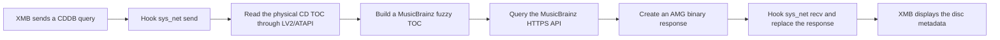

# PS3 CD Info Plugin

[中文](#中文) | [English](#english)

---

## 中文

### 项目简介

PS3 CD Info Plugin 是一个面向 PS3 XMB/VSH 的 SPRX 插件。它从物理光驱读取
音频 CD 的真实 TOC（Table of Contents），使用 TOC 查询 MusicBrainz，并把查询
结果转换为 XMB 原生支持的 **AMG 二进制格式**，从而为音频 CD 显示艺术家、专辑
和曲目名称。

插件生成的目标文件为：

```text
ps3_cd_info_plugin.sprx
```

### 核心改进（v2.0）

基于 [simple-cd-info](https://github.com/mohasi/ps3-dev/tree/main/plugins/simple-cd-info)
项目的逆向工程成果，本版本进行了重大改进：

1. **AMG 二进制格式** — XMB 期望的是 AMG 二进制格式，而非 CDDB 文本格式。
   AMG 是 PS3 固件 `x3_amgsdk` 模块原生解析的格式。

2. **锁机保护** — 9 个危险槽位（10, 13, 14, 16, 17, 18, 21, 24, 25）永远
   不会被写入文本。这些槽位在真机测试中被确认会导致 PS3 硬锁机。

3. **双艺术家支持** — 区分专辑级艺术家（槽位 4）和曲级艺术家（槽位 6 的
   子字符串 2），通过槽位 0 控制显示模式，支持合辑（Various Artists）。

4. **流派支持** — 从 MusicBrainz 获取流派信息，填充 AMG 槽位 9。

### 工作流程


如果直接读取光驱失败，插件会尝试从 XMB 发出的 CDDB query 中还原 TOC 参数；
如果 MusicBrainz 查询或响应解析失败，则保留原始 CDDB 响应，不破坏原请求。

### 模块说明

| 模块 | 功能 |
| --- | --- |
| `src/main.c` | SPRX 启停入口、缓存初始化、网络 Hook 安装和运行日志 |
| `src/toc_reader.c` | 打开物理 BDVD、发送 ATAPI `READ TOC/PMA/ATIP (0x43)`、解析轨道与 Lead-out |
| `src/hook_net.c` | 拦截共享 `sys_net` 的 `send/recv`，提取 CDDB 请求并替换响应 |
| `src/musicbrainz.c` | HTTPS 初始化、MusicBrainz fuzzy TOC 查询、JSON 解析和 LRU 缓存 |
| `src/formatter.c` | 把 MusicBrainz 数据格式化为 AMG 二进制或 CDDB 文本 |
| `src/amg_response.c` | 构建 AMG 二进制响应（XMB 原生格式） |
| `boot_plugins.txt` | Cobra/Mamba 启动插件列表样例 |

### AMG 二进制格式

AMG（All Media Guide）格式是 PS3 固件 `x3_amgsdk` 模块期望的原生格式：

- **专辑记录**：30 个字段的容器
  - 槽位 1：专辑标题（Album）
  - 槽位 4：专辑艺术家（Artist，显示在唱片图标上）
  - 槽位 9：流派（Genre）
  - 槽位 11：套装中的唱片数（Disc Number 后半部分）
  - 槽位 15：轨道组（包含所有轨道记录）
  - 槽位 0：艺术家模式开关（空 = 使用曲级艺术家，非空 = 使用专辑级艺术家）
  - **危险槽位**（10, 13, 14, 16, 17, 18, 21, 24, 25）：写入文本会导致硬锁机

- **轨道记录**：17 个字段的容器
  - 字段 1：轨道标题（Track）
  - 字段 6：4 个子字符串的容器，第 2 个是该轨道的艺术家
  - 字段 15, 16：必须为 int16（0），否则整个专辑被拒绝

### 真实 TOC 读取

`toc_reader.c` 使用 PS3 LV2 storage 接口：

- BDVD 设备 ID：`0x101000000000006`
- `sys_storage_open`：syscall 600
- `sys_storage_close`：syscall 601
- `sys_storage_send_device_command`：syscall 604
- ATAPI 命令：`READ TOC/PMA/ATIP (0x43)`
- 返回格式：Format 0，MSF 地址

读取结果会转换为 MusicBrainz 所需的格式：

```text
FIRST+LAST+LEADOUT+OFFSET1+OFFSET2+...
```

轨道偏移和 Lead-out 的单位均为 CD frame（每秒 75 frame），并包含标准的
150-frame 起始偏移。

### 网络 Hook

PS3 PPU 使用 ELFv1 函数描述符，函数指针包含代码入口和 TOC 寄存器值。
插件会：

1. 从 `netRecv_stub` 和 `netSend_stub` 定位已解析的共享 `sys_net` 导出。
2. 保存函数开头的原始指令。
3. 在可执行段中建立 trampoline。
4. 在进入插件函数前切换到插件自身的 TOC。
5. 通过 PS3MAPI 写当前 VSH 进程的受保护代码页。
6. 插件停止时恢复原始指令。

因此插件需要支持 PS3MAPI 的 Cobra、Mamba 或 PS3HEN 环境。未检测到可用的
PS3MAPI 写内存功能时，插件会拒绝安装 Hook，避免直接写代码页造成 VSH 崩溃。

### 编译环境

需要：

- PS3DEV/PSL1GHT PPU 工具链
- `ppu-gcc`
- `ppu-strip`
- `sprxlinker`
- `fself`
- PSL1GHT 的 HTTP、HTTPS、SSL、NET、SysFS 和 SysModule 库

当前 `makefile` 默认工具链路径为：

```text
/usr/local/ps3dev/ppu
```

如果安装位置不同，请修改 `makefile` 中的 `PREFIX`。

### 编译

```sh
make
```

强制重新编译：

```sh
make -B
```

清理生成文件：

```sh
make clean
```

构建过程依次执行：

1. PPU 交叉编译；
2. 链接 `lv2-sprx.o` 并设置 `_ps3_cd_info_start` 入口；
3. 删除调试信息；
4. 使用 `sprxlinker` 写入 Cell LV2/PRX 元数据；
5. 使用 `fself` 生成最终 SPRX。

### 安装

1. 把文件复制到 PS3：

   ```text
   /dev_hdd0/plugins/ps3_cd_info_plugin.sprx
   ```

2. 在 `/dev_hdd0/boot_plugins.txt` 中加入：

   ```text
   /dev_hdd0/plugins/ps3_cd_info_plugin.sprx
   ```

3. 确认 Cobra/Mamba/PS3HEN 和 PS3MAPI 已启用。
4. 重启 PS3，然后在 XMB 中插入音频 CD。

不要在 OFW 或未提供 PS3MAPI 写内存能力的环境中加载本插件。

### 日志与排错

启动日志写入：

```text
/dev_hdd0/tmp/cd_plugin.log
```

常见问题：

- **日志不存在**：插件可能没有被启动加载器加载，请检查路径及
  `boot_plugins.txt`。
- **`Failed to install network hook`**：通常表示 PS3MAPI 不可用、
  `sys_net` 导入尚未解析，或当前环境不允许修改 VSH 代码页。
- **能播放 CD，但没有新信息**：检查 PS3 网络、DNS、系统时间以及
  MusicBrainz HTTPS 连接。
- **部分唱片查不到**：MusicBrainz 可能没有对应 TOC，或同一 TOC 存在多个
  fuzzy match。
- **插件导致启动异常**：通过所用 CFW/HEN 的安全启动方式禁用启动插件，
  然后删除 `boot_plugins.txt` 中的插件条目。

PS3 系统 SSL 较旧，当前 MusicBrainz HTTPS 的 TLS/证书兼容性必须在具体固件
上验证。若 TLS 握手失败，需要使用兼容的 HTTPS 代理或在后续版本中加入可配置
的查询代理。

### 验证

主机侧测试：

```sh
./test_formatter
./test_hook_logic
./test_json
./tests/test_struct_size
```

检查 PRX 元数据：

```sh
/usr/local/ps3dev/ppu/bin/ppu-readelf -h ps3_cd_info_plugin.elf
/usr/local/ps3dev/ppu/bin/ppu-readelf -x .sys_proc_prx_param \
  ps3_cd_info_plugin.elf
```

应看到：

- PowerPC64、大端 ELF；
- OSABI 字节为 `0x66`（Cell LV2）；
- 存在 `.sys_proc_prx_param`；
- 入口指向 `_ps3_cd_info_start`；
- SPRX 文件头以 `SCE\0` 开始。

### 当前状态

- 已通过 PPU 交叉编译；
- 已通过 SPRX/FSELF 结构检查；
- 已通过现有主机侧测试；
- 尚需在真实 PS3、真实音频 CD 和目标固件组合上完成最终运行验证。

### 致谢

- 特别感谢 [mohasi](https://github.com/mohasi) 及其项目
  [simple-cd-info](https://github.com/mohasi/ps3-dev/tree/main/plugins/simple-cd-info)，
  本项目基于其 AMG 二进制格式的逆向工程成果，没有他的工作就不会有这个插件。
- [MusicBrainz](https://musicbrainz.org/) — 开放的音频 CD 元数据数据库

---

## English

### Overview

PS3 CD Info Plugin is an SPRX plugin for the PS3 XMB/VSH. It reads the real
audio-CD TOC (Table of Contents) from the physical drive, looks it up through
MusicBrainz, and converts the result into the **AMG binary format** natively
understood by XMB. This allows XMB to display the artist, album, and track
titles for an audio CD.

The generated plugin is:

```text
ps3_cd_info_plugin.sprx
```

### Key Improvements (v2.0)

Based on the reverse-engineering work from
[simple-cd-info](https://github.com/mohasi/ps3-dev/tree/main/plugins/simple-cd-info):

1. **AMG Binary Format** — XMB expects AMG binary format, not CDDB text.
   AMG is the native format parsed by the PS3 firmware's `x3_amgsdk` module.

2. **Lock-up Protection** — 9 dangerous slots (10, 13, 14, 16, 17, 18, 21, 24,
   25) are never written with text. These slots were confirmed to hard-lock the
   PS3 on real hardware.

3. **Dual Artist Support** — Distinguishes album-level artist (slot 4) from
   track-level artist (slot 6, sub-string 2), controlled by slot 0. Supports
   compilation albums (Various Artists).

4. **Genre Support** — Fetches genre from MusicBrainz and populates AMG slot 9.

### Runtime flow



If direct drive access fails, the plugin attempts to reconstruct the TOC from
XMB's outgoing CDDB query. If the MusicBrainz lookup or response parsing fails,
the original CDDB response is returned unchanged.

### Modules

| Module | Responsibility |
| --- | --- |
| `src/main.c` | SPRX start/stop entry points, cache initialization, hook setup, and logging |
| `src/toc_reader.c` | Opens the physical BDVD device, sends ATAPI `READ TOC/PMA/ATIP (0x43)`, and parses tracks and lead-out |
| `src/hook_net.c` | Hooks the shared `sys_net` `send/recv` exports, captures CDDB queries, and replaces responses |
| `src/musicbrainz.c` | Initializes HTTPS, performs MusicBrainz fuzzy TOC queries, parses JSON, and manages the LRU cache |
| `src/formatter.c` | Formats MusicBrainz metadata as AMG binary or CDDB text |
| `src/amg_response.c` | Builds AMG binary response (XMB native format) |
| `boot_plugins.txt` | Example Cobra/Mamba boot-plugin list |

### AMG Binary Format

AMG (All Media Guide) format is the native format expected by the PS3 firmware's
`x3_amgsdk` module:

- **Album Record**: 30-field container
  - Slot 1: Album title (Album)
  - Slot 4: Album artist (Artist, shown on disc icon)
  - Slot 9: Genre
  - Slot 11: Number of discs in set (second half of Disc Number)
  - Slot 15: Track group (contains all track records)
  - Slot 0: Artist mode switch (empty = use track-level artist, filled = use album-level artist)
  - **Dangerous slots** (10, 13, 14, 16, 17, 18, 21, 24, 25): Writing text causes hard lock-up

- **Track Record**: 17-field container
  - Field 1: Track title (Track)
  - Field 6: Container of 4 sub-strings, 2nd is the track's artist
  - Fields 15, 16: Must be int16 (0) or the entire album is rejected

### Real TOC access

`toc_reader.c` uses the PS3 LV2 storage interface:

- BDVD device ID: `0x101000000000006`
- `sys_storage_open`: syscall 600
- `sys_storage_close`: syscall 601
- `sys_storage_send_device_command`: syscall 604
- ATAPI command: `READ TOC/PMA/ATIP (0x43)`
- Response format: Format 0 with MSF addresses

The parsed TOC is converted to the MusicBrainz fuzzy lookup format:

```text
FIRST+LAST+LEADOUT+OFFSET1+OFFSET2+...
```

Track offsets and the lead-out are expressed in CD frames (75 frames per
second) and include the standard 150-frame starting offset.

### Network hook

The PS3 PPU uses ELFv1 function descriptors: a function pointer contains both
the code entry address and the TOC register value. The plugin:

1. Resolves the shared `sys_net` exports through `netRecv_stub` and
   `netSend_stub`.
2. Saves the original prologue instructions.
3. Creates executable trampolines.
4. Switches to the plugin's TOC before entering hook code.
5. Uses PS3MAPI to patch protected pages in the current VSH process.
6. Restores the original instructions when the plugin stops.

The plugin therefore requires a Cobra, Mamba, or PS3HEN environment with
PS3MAPI support. If protected-memory writing is unavailable, hook installation
fails safely instead of attempting a direct write that could crash VSH.

### Build requirements

- PS3DEV/PSL1GHT PPU toolchain
- `ppu-gcc`
- `ppu-strip`
- `sprxlinker`
- `fself`
- PSL1GHT HTTP, HTTPS, SSL, NET, SysFS, and SysModule libraries

The default toolchain prefix in `makefile` is:

```text
/usr/local/ps3dev/ppu
```

Change `PREFIX` in `makefile` if your toolchain is installed elsewhere.

### Building

```sh
make
```

Force a complete rebuild:

```sh
make -B
```

Remove generated files:

```sh
make clean
```

The build pipeline:

1. Cross-compiles the sources for PPU;
2. links `lv2-sprx.o` and selects `_ps3_cd_info_start` as the entry point;
3. removes debug information;
4. writes Cell LV2/PRX metadata with `sprxlinker`;
5. packages the final SPRX with `fself`.

### Installation

1. Copy the plugin to:

   ```text
   /dev_hdd0/plugins/ps3_cd_info_plugin.sprx
   ```

2. Add this line to `/dev_hdd0/boot_plugins.txt`:

   ```text
   /dev_hdd0/plugins/ps3_cd_info_plugin.sprx
   ```

3. Make sure Cobra/Mamba/PS3HEN and PS3MAPI are enabled.
4. Restart the PS3 and insert an audio CD while in XMB.

Do not load the plugin on OFW or in an environment without PS3MAPI protected
memory-write support.

### Logging and troubleshooting

The plugin writes its startup log to:

```text
/dev_hdd0/tmp/cd_plugin.log
```

Common issues:

- **No log file:** verify the plugin path and `boot_plugins.txt`.
- **`Failed to install network hook`:** PS3MAPI may be unavailable, the
  `sys_net` imports may not be resolved, or the environment may reject VSH text
  modifications.
- **The CD plays but no new metadata appears:** check network access, DNS,
  system time, and MusicBrainz HTTPS connectivity.
- **Some discs are not found:** MusicBrainz may not contain the TOC, or the TOC
  may produce multiple fuzzy matches.
- **Boot problem after installation:** use the safe-boot mechanism provided by
  your CFW/HEN loader to disable boot plugins, then remove the plugin entry.

The PS3 system SSL implementation is old. Compatibility with the current
MusicBrainz TLS and certificate configuration must be verified on the target
firmware. A compatible HTTPS proxy may be required if the TLS handshake fails.

### Validation

Run the existing host-side tests:

```sh
./test_formatter
./test_hook_logic
./test_json
./tests/test_struct_size
```

Inspect the PRX metadata:

```sh
/usr/local/ps3dev/ppu/bin/ppu-readelf -h ps3_cd_info_plugin.elf
/usr/local/ps3dev/ppu/bin/ppu-readelf -x .sys_proc_prx_param \
  ps3_cd_info_plugin.elf
```

Expected properties:

- PowerPC64 big-endian ELF;
- OSABI byte `0x66` (Cell LV2);
- a `.sys_proc_prx_param` section;
- an entry point for `_ps3_cd_info_start`;
- an SPRX beginning with the `SCE\0` magic.

### Current status

- PPU cross-build passes;
- SPRX/FSELF structural validation passes;
- existing host-side tests pass;
- final runtime validation still requires a physical PS3, an audio CD, and the
  target firmware environment.

### Credits

- Special thanks to [mohasi](https://github.com/mohasi) and his project
  [simple-cd-info](https://github.com/mohasi/ps3-dev/tree/main/plugins/simple-cd-info).
  This plugin is built on his reverse-engineering work of the AMG binary format;
  without his work this plugin would not exist.
- [MusicBrainz](https://musicbrainz.org/) — Open audio CD metadata database
